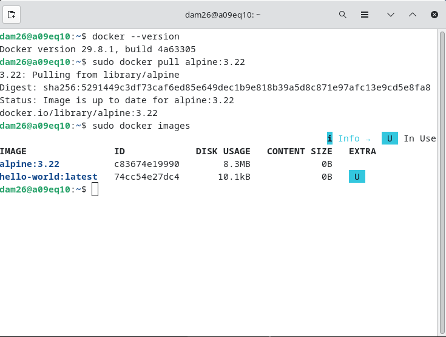
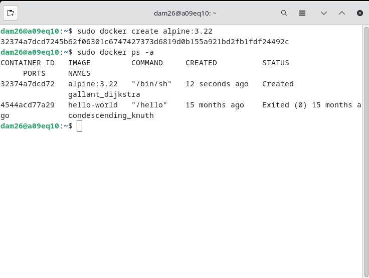
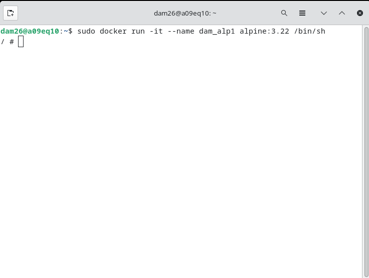
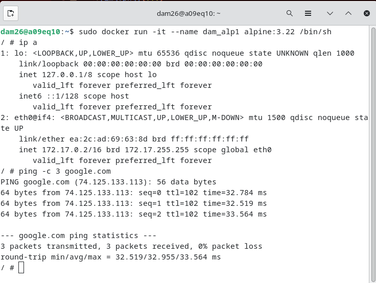
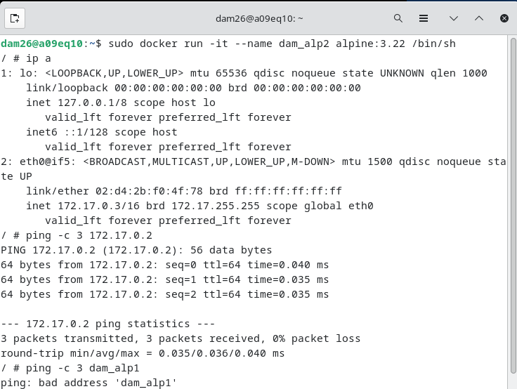
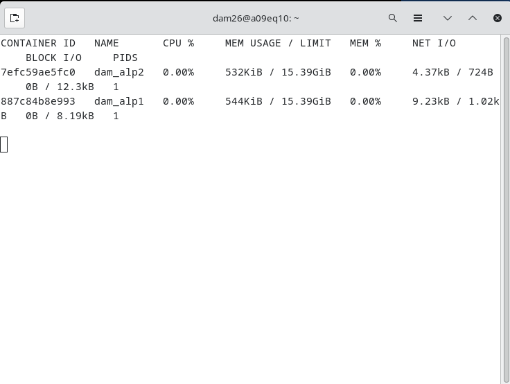
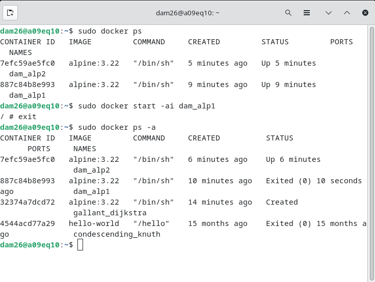
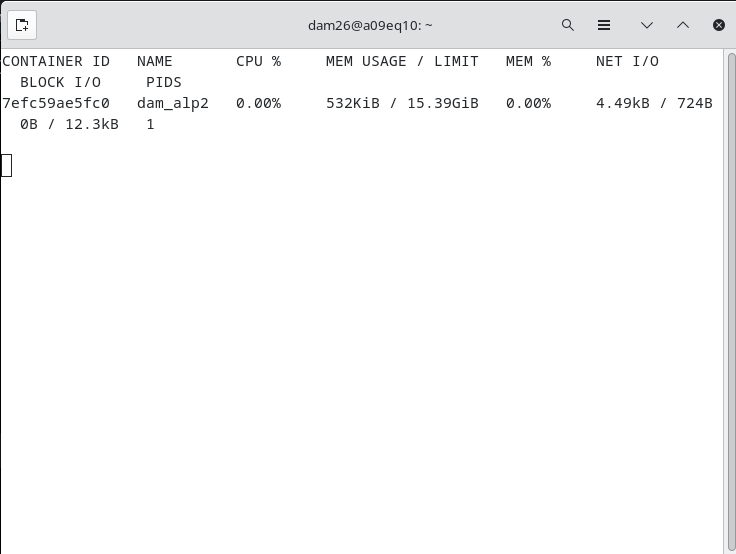
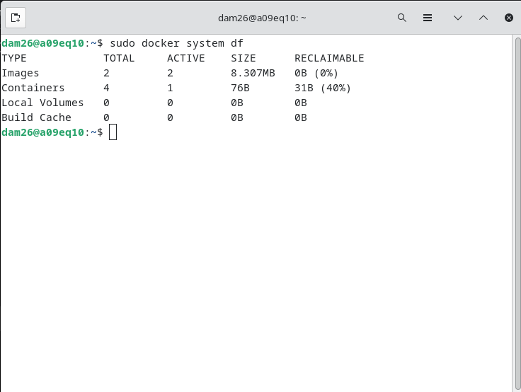

# Práctica Docker: imágenes, contenedores y redes

**Alumno:** René Chamorro Crugeiras  
**Curso:** CFGS DAM 2  
**Módulo:** Programación de servicios y procesos    

## 1. Descargar la imagen de Alpine

Primero comprobar la versión de Docker instalada:

```bash
docker --version
```

Después hay que descargar Alpine utilizando una versión concreta, sin utilizar `latest`:

```bash
sudo docker pull alpine:3.22
```

Para comprobar que la imagen está descargada hay que utilizar:

```bash
sudo docker images
```

La imagen descargada es `alpine:3.22`.



---

## 2. Crear un contenedor sin nombre

Necesitas crear un contenedor sin arrancarlo y sin indicar ningún nombre:

```bash
sudo docker create alpine:3.22
```

Después comprobar los contenedores existentes:

```bash
sudo docker ps -a
```

El contenedor queda en estado **Created**.

Como no se indica ningún nombre, Docker le asigna automáticamente el nombre:

`gallant_dijkstra`



---

## 3. Crear y arrancar `dam_alp1`

Crear y arrancar un contenedor llamado `dam_alp1` con una shell:

```bash
sudo docker run -it --name dam_alp1 alpine:3.22 /bin/sh
```

Al ejecutarlo entras directamente dentro del contenedor y aparece:

```text
/ #
```

Las opciones a utilizar son:

* `-i`: permite introducir datos por teclado.
* `-t`: proporciona una terminal.
* `--name dam_alp1`: establece el nombre del contenedor.
* `/bin/sh`: abre la shell de Alpine.



---

## 4. Comprobar la IP y conexión a Internet

Desde dentro de `dam_alp1` es necesario ejecutar:

```bash
ip a
```

La dirección IP del contenedor será parecida a:

```text
172.17.0.2
```

Después hay que comprobar si tiene conexión con Internet:

```bash
ping -c 3 google.com
```

El resultado será de **3 paquetes enviados, 3 recibidos y 0% de pérdida**, por lo que el contenedor tendrá conexión.



---

## 5. Comunicación entre `dam_alp1` y `dam_alp2`

Primero dejas `dam_alp1` funcionando sin pararlo utilizando:

```text
Ctrl + P
Ctrl + Q
```

Después creas `dam_alp2`:

```bash
sudo docker run -it --name dam_alp2 alpine:3.22 /bin/sh
```

La IP de `dam_alp2` será:

```text
172.17.0.3
```

### Ping por IP

Desde `dam_alp2` haces ping a `dam_alp1` mediante su IP:

```bash
ping -c 3 172.17.0.2
```

El ping funciona correctamente, con 3 respuestas y 0% de pérdida.

### Ping por nombre

Después intentas hacer ping utilizando el nombre:

```bash
ping -c 3 dam_alp1
```

El resultado será:

```text
ping: bad address 'dam_alp1'
```

Esto ocurre porque los dos contenedores están utilizando la red `bridge` predeterminada. En esta red los contenedores pueden comunicarse mediante su dirección IP, pero no mediante su nombre.



---

## 6. Consumo de memoria

Con los dos contenedores funcionando se utiliza:

```bash
sudo docker stats
```

El resultado mostrará:

* `dam_alp1`: **544 KiB** de memoria.
* `dam_alp2`: **532 KiB** de memoria.

`docker stats` permite consultar el consumo de recursos de los contenedores en ejecución.



---

## 7. Salir del contenedor

Para comprobar qué ocurre al salir, hay que volver a entrar en `dam_alp1`:

```bash
sudo docker start -ai dam_alp1
```

Después ejecutar:

```bash
exit
```

Al salir, `dam_alp1` pasa a estado:

```text
Exited (0)
```

Mientras tanto, `dam_alp2` continua funcionando.

Se comprueba el estado con:

```bash
sudo docker ps -a
```

Después vuelves a ejecutar:

```bash
sudo docker stats
```

Ahora solamente aparece `dam_alp2`, porque `dam_alp1` está parado.

Esto ocurre porque `/bin/sh` era el proceso principal del contenedor. Al terminar la shell con `exit`, termina el proceso principal y el contenedor se detiene.





---

## 8. Espacio ocupado en disco

Finalmente comprobar el espacio utilizado por Docker:

```bash
sudo docker system df
```

El resultado será:

```text
TYPE            TOTAL     ACTIVE    SIZE      RECLAIMABLE
Images          2         2         8.307MB   0B (0%)
Containers      4         1         76B       31B (40%)
Local Volumes   0         0         0B        0B
Build Cache     0         0         0B        0B
```

Se puede distinguir entre:

* **Images:** las imágenes almacenadas ocupan 8.307 MB.
* **Containers:** los contenedores ocupan 76 B.
* **Local Volumes:** no hay volúmenes.
* **Build Cache:** no hay caché de construcción.



---

## Conclusión

En esta práctica se trabajó con imágenes y contenedores Docker utilizando Alpine 3.22.

Se comprobó cómo crear contenedores, arrancarlos, acceder a una shell, consultar su IP, comprobar la conexión a Internet, comunicar contenedores mediante IP, consultar su consumo de memoria y comprobar el espacio utilizado en disco.
