# Instalación de Dolibarr junto a WordPress

## 1. Introducción

En esta práctica se instala **Dolibarr** en una máquina virtual Ubuntu que ya dispone de **WordPress**, haciendo que las dos aplicaciones funcionen en el mismo servidor web Apache.

El objetivo es instalar Dolibarr sin afectar al WordPress existente, utilizando una base de datos y un usuario independientes.

### Entorno utilizado

* Ubuntu 24.04.5 LTS
* Apache 2.4.58
* PHP 8.3.6
* MariaDB 10.11.14
* WordPress
* Dolibarr 24.0.1

---

## 2. Comprobación del entorno

Antes de instalar Dolibarr se comprobó que el servidor ya tenía funcionando Apache, PHP y MariaDB.

También se realizó una instantánea de la máquina virtual antes de realizar cambios importantes.

**Estado inicial de la máquina virtual**

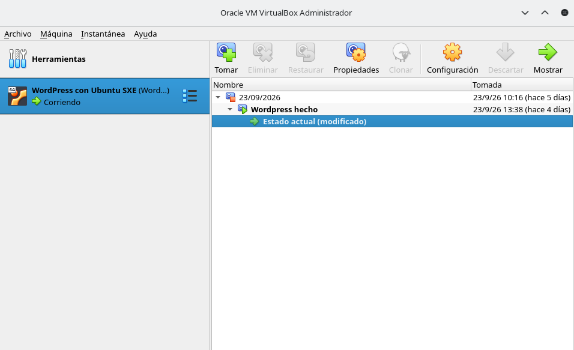

---

## 3. Preparación de la instalación

Primero se actualizaron los paquetes del sistema:

```bash
sudo apt update
```

Después se instalaron las herramientas necesarias para descargar y descomprimir Dolibarr:

```bash
sudo apt install wget unzip -y
```

**Actualización e instalación de herramientas**

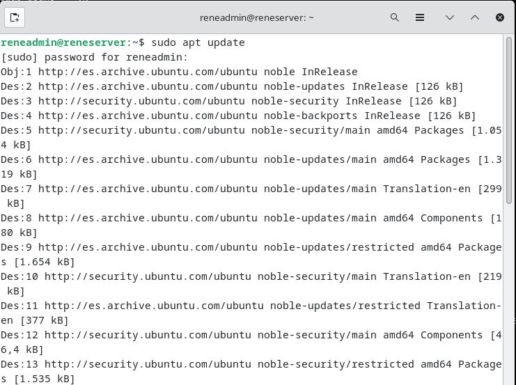

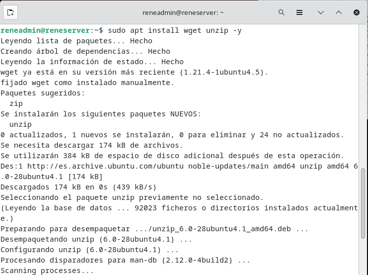

---

## 4. Creación de la base de datos

Para evitar utilizar la misma base de datos que WordPress, se creó una base de datos independiente para Dolibarr.

Se accedió a MariaDB:

```bash
sudo mysql
```

Se creó la base de datos:

```sql
CREATE DATABASE dolibarr CHARACTER SET utf8mb4 COLLATE utf8mb4_general_ci;
```

Después se creó un usuario exclusivo para Dolibarr:

```sql
CREATE USER 'dolibarr_user'@'localhost' IDENTIFIED BY 'CONTRASEÑA_DOLIBARR';
```

Se le dieron permisos únicamente sobre la base de datos de Dolibarr:

```sql
GRANT ALL PRIVILEGES ON dolibarr.* TO 'dolibarr_user'@'localhost';
```

Finalmente:

```sql
FLUSH PRIVILEGES;
```

Y se salió de MariaDB:

```sql
EXIT;
```

La contraseña real no se incluye en este manual por motivos de seguridad.

**Creación de la base de datos y usuario**

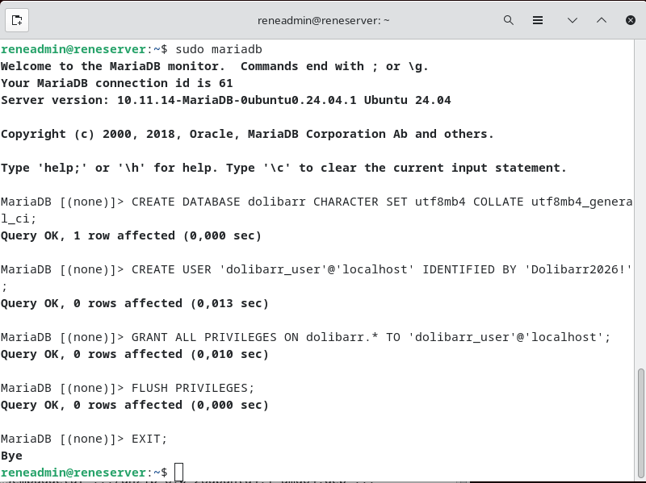

---

## 5. Descarga de Dolibarr

Se descargó la versión 24.0.1 de Dolibarr.

Primero se accedió al directorio temporal:

```bash
cd /tmp
```

Después se descargó el paquete:

```bash
wget https://www.dolibarr.org/files/stable/standard/dolibarr-24.0.1.tgz
```

Se comprobó que el archivo se había descargado:

```bash
ls -lh dolibarr-24.0.1.tgz
```

**Descarga de Dolibarr**

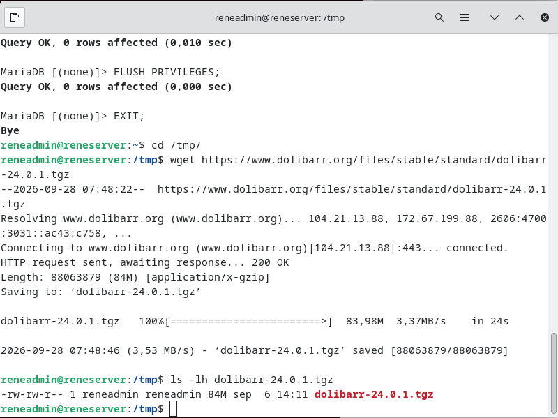

---

## 6. Instalación de los archivos

Se descomprimió el archivo:

```bash
tar -xzf dolibarr-24.0.1.tgz
```

Después se movió la instalación a `/var/www`:

```bash
sudo mv dolibarr-24.0.1 /var/www/dolibarr
```

Se comprobó el contenido de `/var/www`:

```bash
ls /var/www
```

El objetivo era mantener la instalación de Dolibarr separada del directorio utilizado por WordPress.

**Directorios de WordPress y Dolibarr**

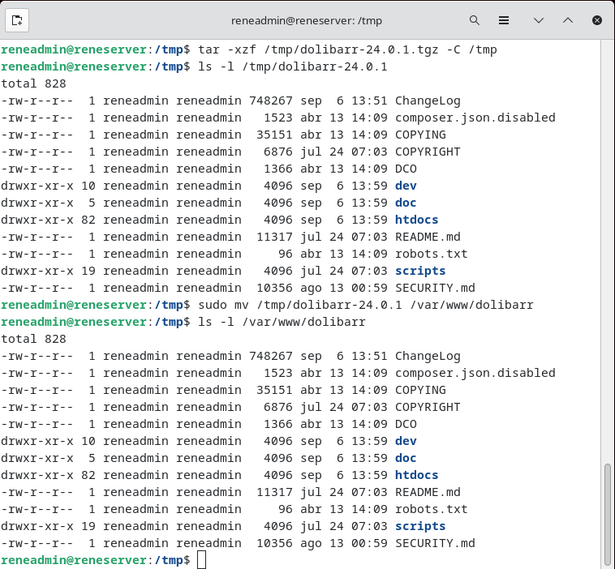

---

## 7. Configuración de permisos

Se asignó el propietario de los archivos al usuario de Apache:

```bash
sudo chown -R www-data:www-data /var/www/dolibarr
```

Después se establecieron permisos para los directorios:

```bash
sudo find /var/www/dolibarr -type d -exec chmod 755 {} \;
```

Y para los archivos:

```bash
sudo find /var/www/dolibarr -type f -exec chmod 644 {} \;
```

**Configuración de permisos**

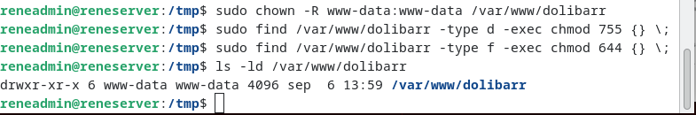

---

## 8. Crear la configuración de Apache

Primero vamos a crear un archivo específico para Dolibarr

Se creó:

```bash
sudo nano /etc/apache2/conf-available/dolibarr.conf
```

Se abrirá nano, y hay que pegar exactamente esto:

```bash
Alias /dolibarr /var/www/dolibarr/htdocs

<Directory /var/www/dolibarr/htdocs>
    Options FollowSymLinks
    AllowOverride All
    Require all granted
</Directory>
```

En "nano": Ctrl + O -> Enter -> Ctrl + X

Para activar la configuración se ejecuta:

```bash
sudo a2enconf dolibarr
```

Y comprobamos que la configuración de Apache no tiene errores:

```text
sudo apache2ctl configtest
```

**Configuración de Apache**

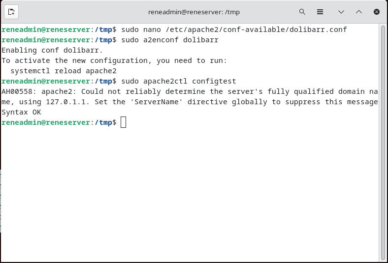

---

## 9. Configuración del instalador de Dolibarr

Se accedió al instalador web de Dolibarr.

Los principales parámetros utilizados fueron:

| Parámetro                | Valor                         |
| ------------------------ | ----------------------------- |
| Directorio web           | `/var/www/dolibarr/htdocs`    |
| URL                      | `http://10.0.9.227/dolibarr`  |
| Base de datos            | `dolibarr`                    |
| Servidor                 | `localhost`                   |
| Controlador              | `mysqli`                      |
| Usuario                  | `dolibarr_user`               |
| Prefijo de tablas        | `llx_`                        |
| Directorio de documentos | `/var/lib/dolibarr/documents` |

La creación de la base de datos se dejó desmarcada porque la base de datos ya había sido creada manualmente.

**Configuración de Dolibarr**

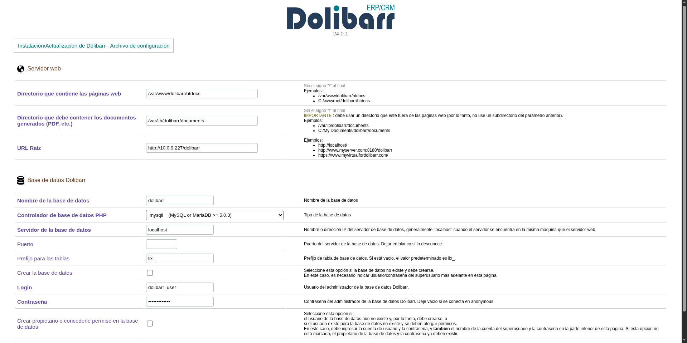

---

## 10. Comprobación de la conexión

Después de continuar con la instalación, Dolibarr confirmó que la conexión con MariaDB funcionaba correctamente.

Se comprobó:

* conexión con `localhost`;
* usuario `dolibarr_user`;
* base de datos `dolibarr`;
* creación correcta del archivo `conf.php`.

**Conexión correcta con MariaDB**

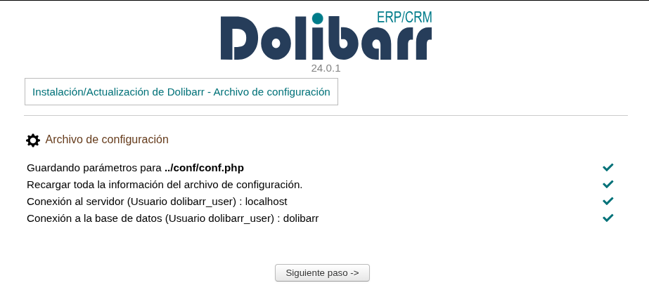

Esta pantalla demuestra que Dolibarr puede acceder correctamente a su base de datos.

---

## 11. Comprobación de Dolibarr

Finalmente se accedió a:

```text
http://10.0.9.227/dolibarr
```

y se comprobó que Dolibarr funcionaba correctamente.

**Dolibarr funcionando**

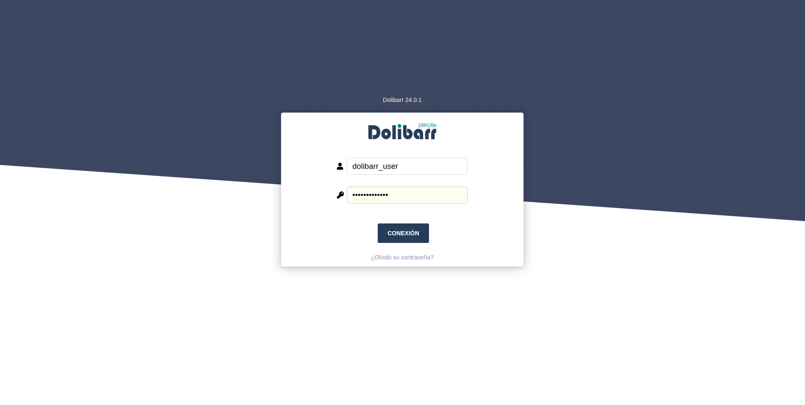

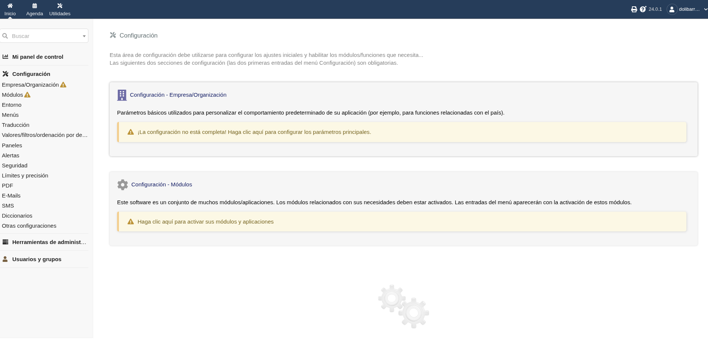

---

## 12. Convivencia de las aplicaciones

WordPress y Dolibarr funcionan en el mismo servidor Apache, pero se mantienen separados.

La organización utilizada es:

```text
Servidor Ubuntu
│
├── Apache
│   ├── WordPress
│   └── Dolibarr
│
├── Base de datos WordPress
│
└── Base de datos Dolibarr
    └── Usuario dolibarr_user
```

De esta forma, Dolibarr dispone de su propia base de datos y usuario, evitando utilizar directamente los datos de WordPress.

---

## 13. Problemas encontrados y soluciones

### Directorio de documentos

El instalador indicó que el directorio de documentos no debía encontrarse dentro del directorio público de la aplicación.

**Solución:**

Se creó:

```bash
sudo mkdir -p /var/lib/dolibarr/documents
```

y se utilizó esta ruta durante la instalación:

```text
/var/lib/dolibarr/documents
```

### Base de datos

Se decidió crear previamente la base de datos y el usuario de Dolibarr para mantenerlos separados de WordPress.

---

## 14. Resultado final

Al finalizar la práctica se consiguió instalar Dolibarr en la misma máquina virtual que WordPress.

El resultado final es:

* Apache funcionando.
* PHP funcionando.
* MariaDB funcionando.
* WordPress funcionando.
* Dolibarr funcionando.
* Base de datos independiente para Dolibarr.
* Usuario independiente para Dolibarr.
* Directorio de documentos separado.
* WordPress no se vio afectado por la instalación.
* Dolibarr es accesible desde el navegador.

La instalación queda preparada para utilizar ambas aplicaciones simultáneamente en el mismo servidor.
